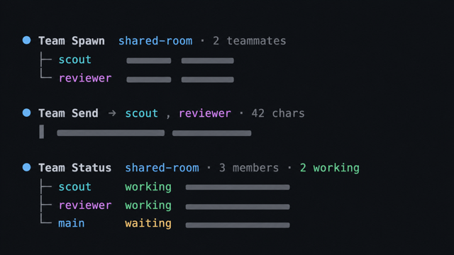
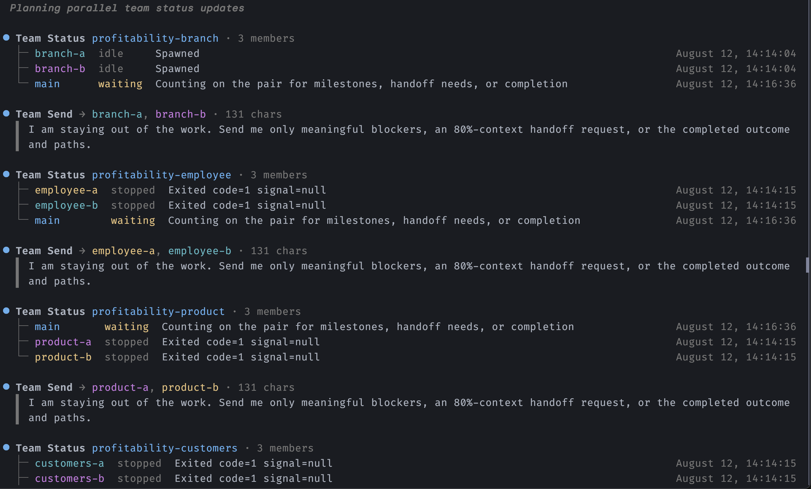
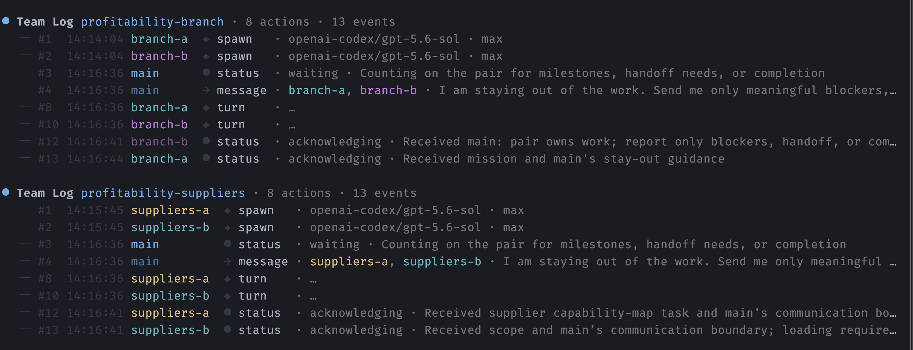
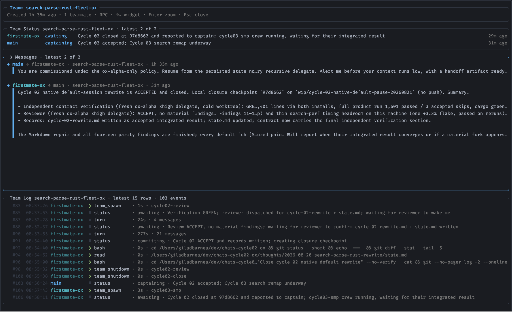
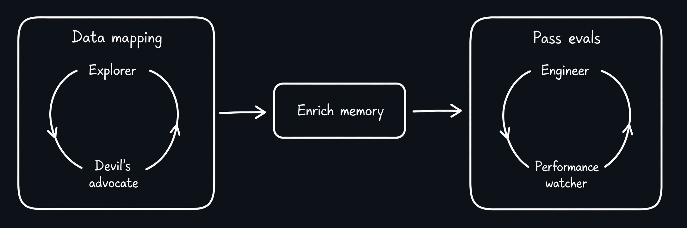

<div align="center">

# pi-simple-team

> **The team extension with no features.**

<p align="center">
  <a href="https://github.com/earendil-works/pi"></a>
  <a href="https://www.npmjs.com/package/@giladbarnea/pi-simple-team"></a>
  <a href="https://github.com/giladbarnea/pi-simple-team/actions/workflows/test.yml"></a>
  <a href="LICENSE"></a>
  <a href="https://www.typescriptlang.org/"></a>
  <a href="https://bun.sh/"></a>
</p>

**No roles. No org chart. No mailboxes. No routing rules.**

`pi-simple-team` spawns a small team of Pi agents that can all talk to each other, like the responsible adults they are, **and then stays out of the way.**

</div>

---


## Why

I did my best work in a small room, together with a bunch of very capable people.

> <span style="color:grey">_[shouts]_</span> Has anyone figured out how to set up auth yet?

Not filing a "request for assistance".

> <span style="color:grey">_[taps shoulder]_</span> Dude can you grill me on this plan?

Not scheduling a meeting.

**That's the whole design. Not a swarm, not a company. *A room.***

## Install

Requires Pi 1.1.0 or newer.

```sh
pi install npm:@giladbarnea/pi-simple-team
```

Communication skills from [`soft-skills`](https://www.npmjs.com/package/soft-skills) are included and available through Pi's normal skill discovery.

## Using `pi-simple-team`

Tell your main agent:
> Spawn a team.

That's it. The team takes the shape of the mission:

You:
> Create an implementer-reviewer team to complete `PLAN.md`.

Main agent:
> Created an `implementer` and `reviewer` loop:
> - `implementer` will keep fixing until `reviewer` is satisfied.
> - I will let you know when they are done.

[](screenshots/abstract-tool-output-preview.png)

<div align="center"><em>Spawn, direct, and follow a team from the normal Pi conversation.</em></div>

<br>

<details>
<summary><strong>pi-simple-team screenshots</strong></summary>

<br>

<p align="center">
  <a href="screenshots/team-status-multiple.png"></a>
  </p>
  <p align="center">
  <a href="screenshots/team-log-multiple.png"></a>
</p>

</details>

### Watch a live team with `/team`.

`/team` is for you, not another agent tool. It gives you a live view of the room without turning the main agent into a status relay.

The command opens an overlay rolling recent statuses, messages, and a separate event log.

Up/Down select the messages or log widget. Enter zooms it to the full overlay. Esc goes back.

<a href="screenshots/team-view.png">
  
</a>

<div align="center"><em>The live, read-only <code>/team</code> dashboard.</em></div>


## The mechanics

### 🏋️ Woken up when needed. Works freely otherwise.

**Tokens, intelligence and time are never wasted on busy-polling for messages.**

Instead, `pi-simple-team` pushes messages to the recipients.

This is both efficient and effective:

- ✔ No inbox to forget.
- ✔ Context window stays lean.
- ✔ Unlocks arbitrary workflows.

### ⚡ Messages arrive _fast_.

- Sub-second, when the recipient is idle.
- The moment the current bout of work ends, when busy.

### 🟢 Statuses everyone can see.

For free, at any time. Like setting a Slack status.

Teammates publish a one-liner:

> <span style="color:grey">implementer  </span> Done, 89 tests green, awaiting review.

> <span style="color:grey">reviewer      </span> Reading implementation, will finalize review in a few minutes.

Your main agent calls `team_status` and understands exactly what is going on. Main does not ask teammates for updates or clutter their context.

### 🌡️ Context window self-awareness

**The team manages its own context:**

Teammates know how much free context they have left.

Main agent knows its own and everyone else's too.

They will hand off work autonomously when it's time to say goodbye.

You can stop babysitting context windows.

### 📣 Interrupts, when justified.

> _Situation: Late afternoon. Team finished production hotfix and started wrap up. There is one problem though._

- 17:32:00: `security-guard` spots a private SSH key not covered by `.gitignore`.
- 17:32:01: `release-owner` sets status: _Ran `git add .`, preparing commit and push._
- 17:32:02: `security-guard` immediately interrupts `release-owner`. Key never leaves the machine. Developer keeps their job another day 👍

### 📡 Live, zero-cost observability 

Your main uses `team_log` when it needs to understand the chain of events in high granularity.

Provides main a timestamped, filterable, append-only record of the team’s messages, tool calls, and lifecycle events.
Attempts can end before retries finish. A separate run row reports final settlement as ended or cancelled. Ended does not imply success.

### 🌅 Herdr Support

`pi-simple-team` can open a teammate direct Pi session in a dedicated [Herdr](https://herdr.dev) pane. Just ask your main agent to do that.

- Live view of the room.
- Talk directly with teammates.

  I recommend starting with “Captain here”. Feels good and the surprise on their faces is priceless.

### 🧱 Teammates are durable Pi sessions.

A teammate is just a Pi session with a team attachment.

This means **teammates (and thus, teams) survive shutdown.**

Have a teammate do work, exit Pi entirely, come back tomorrow in a brand-new session, and ask main to get you that teammate by its Pi session id. Everything it learned stays intact.

You can even `/resume` a teammate session directly if you ever want a cozy one-on-one, or run `pi --session <teammate-session-id>`.

## 🪾 It’s teams all the way down (optionally)

Tell main you want to **have a teammate manage its own team(s).**

This is a powerful technique to create a **separate layer of context.**

That teammate will spawn, steer and observe its own team(s) without costing tokens to its siblings or parent.

The tradeoff, like any higher-order delegation, is reduced control: you are moved one level further away from the trenches.

This is opt-in: teammates by default can't create teams.

This technique plays even nicer if your main assumes the captain rank[^1].

---

## 🧬 Graphs engineer themselves

**Because** it does nothing special, `pi-simple-team` can **construct any agentic graph you need.**

Tell main:
> 1. Break `PLAN.md` into a task graph. Include loops with success criteria and run independent tasks in parallel.
> 2. Create a team that carries out that task graph.

Or give main a concrete team goal:
> **Team goal:**
> 1. Map the database for all customer ⟷ purchases money streams.
> 2. Feed the new knowledge into the memory layer.
> 3. Make the data analysis agent pass the new purchases evals. 
> 
> **Note:**
> - #1 is a **saturation loop.** Stop only when you can't find anything new. 
> - #3 is a **hill-climbing loop.** Stop only the evals are green.
> - Teammates #1 and #3 create their own teams to loop until task is complete.

That prompt creates this graph:



## Tools

Kept minimal:


| Role | For | Tools |
| --- | --- | --- |
| **Main agent** | Team lifecycle | `team_spawn`, `team_list`, `team_resume`, `team_add_teammates`, `team_shutdown` |
| | With team | `team_send_message` |
| | On team | `team_status`, `team_log` |
| | On everyone | `get_context_window_usage` |
| | On self | `schedule_reminder` |
| **Managing teammate** | On self and own teams | Same tools as the main agent |
| | With parent team | `team_send_message`, `team_status`, `send_main_message` |
| **Teammates** | With team | `team_send_message` |
| | With main | `send_main_message` |
| | On self | `get_context_window_usage` |
| **Everyone** | For everyone | `team_status` |

`team_spawn`, `team_resume`, and `team_add_teammates` start work automatically once every affected teammate is ready. With `startIdle: true`, their briefings wait in context without starting work.

Startup delivers `commonPrompt` inside `<team-system-message>` and each teammate's `systemPrompt` inside `<your-specific-system-message>`. These are labels in the custom team message, not system-role overrides. The briefing also contains the teammate's identity and coordination guidance.

Resume appends a custom briefing with the team identity, current time, and last recorded model activity. Optional `resumptionPrompt` instructions follow that briefing without changing saved definitions. With `startIdle: true`, the briefing waits in context for the next turn.

Existing teammates can be selected by name or Pi session ID in the same input field. Messages, logs, and context usage share a `targets` list. Select a team for all its teammates, or select individual teammates across your teams. Ambiguous names return IDs you can use instead.

Spawn, resume, and add return the complete roster. Results distinguish a live runtime from active work, including work that was already underway before the call.

Set `showOnHerdrPane: true` on individual teammates to open their panes. An explicit `showOnHerdrPanes` value on spawn overrides all individual settings.

`extensionPaths` lists trusted, existing absolute extension paths for one teammate. RPC and Herdr launches load them alongside the team runtime, and resume keeps them. Discovered extensions remain disabled. These modules run with the same permissions as Pi.

Message tools return `published: true` when the extension accepts a message for delivery. If delivery later fails, the sender receives the error automatically.


---


## Roadmap

**User involvement track:**

- [x] Herdr panes for teammates.
- [x] `/team`: live, read-only team dashboard.
- [ ] Teammate drill-down and transcripts.
- [ ] Joining and steering teams from slash commands.
- [ ] Adding teammates to existing teams directly from slash commands.
- [ ] Spawning teams directly from slash commands.

**Functional:**

- [x] Resume all or selected teammates from a dormant team.
- [x] Add teammates after a team has spawned.
- [x] Let opted-in teammates create and manage teams of their own.
- [x] Remove teammates from a team.
- [ ] Main triggers `/compact` on select teammate.
- [ ] Teammates auto-reminded to hand off on low context.

---

[^1]: [Captain](https://github.com/giladbarnea/soft-skills/blob/main/plugins/soft-skills/skills/ai-to-delegated/coordination/leading-leaders.md) in the `ai-to-delegated` skill.
